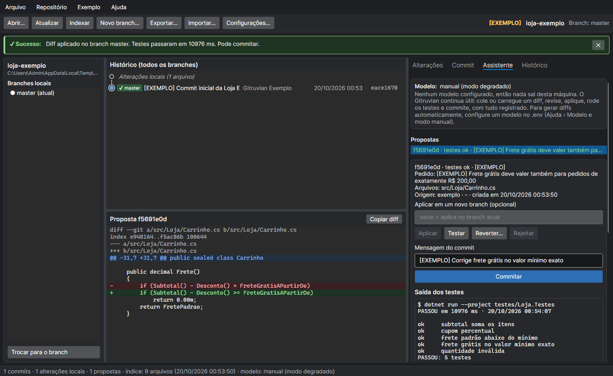
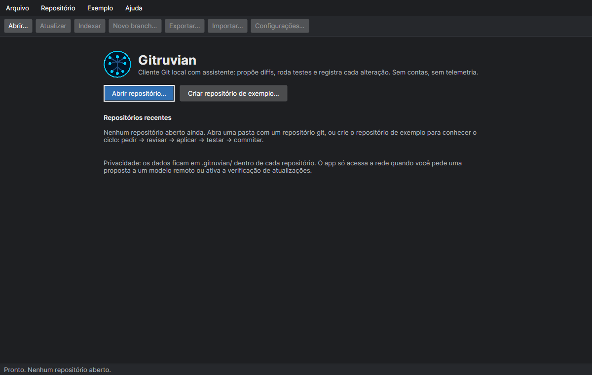
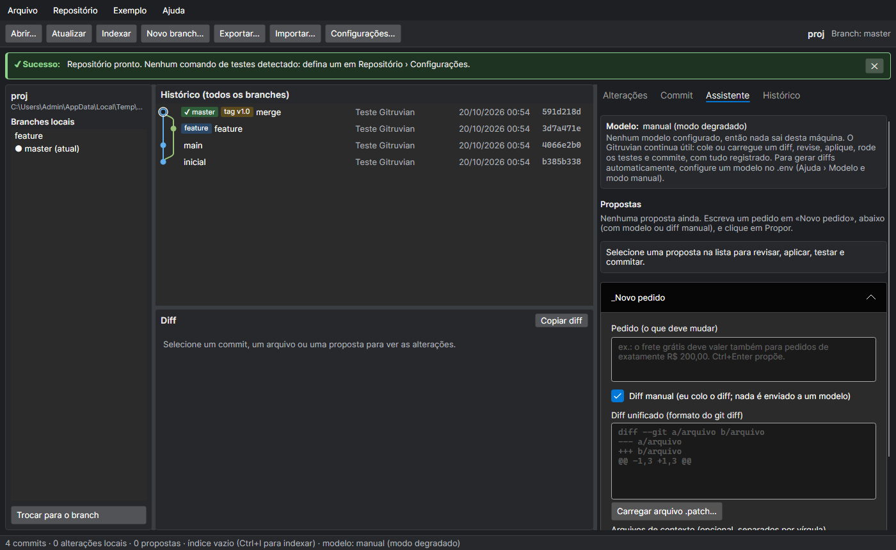

# Gitruvian

Cliente Git **gráfico, local, privado e de usuário único** para Windows, no estilo do
GitKraken/SourceGit, com um assistente que propõe diffs, roda os testes e registra cada alteração:

```
indexar o código → pedir uma alteração → receber um diff → revisar → aplicar → rodar os testes → commitar ou reverter
                                       (cada passo fica registrado num banco SQLite local)
```



A janela tem três áreas:

- **Esquerda:** branches locais (Enter ou duplo clique troca de branch).
- **Centro:** histórico de todos os branches com **grafo de commits** (raias coloridas, merges,
  etiquetas de branch e tag, linha "Alterações locais") e, abaixo, o **visualizador de diff**
  (linhas adicionadas/removidas com cor e com o sinal `+`/`-`, botão Copiar diff).
- **Direita, em abas:** **Alterações** (preparar/remover do stage, descartar, mensagem e commit),
  **Commit** (detalhes e arquivos do commit selecionado), **Assistente** (proposta → aplicar →
  testar → commitar/reverter/rejeitar, e o formulário de novo pedido) e **Histórico** (trilha de
  auditoria).

Stack: **C# / .NET 10 + Avalonia 12** (interface), **SQLite** (Microsoft.Data.Sqlite, com FTS5),
**Velopack** (instalador e atualização automática). Sem servidor, sem conta, sem analytics, sem
telemetria, sem anúncios.

> A primeira versão foi escrita em Python 3.12 + Typer + SQLite e foi removida do repositório (a
> versão de linha de comando continua no histórico do git, no commit `f028181`). O banco e o
> formato de exportação não mudaram: dados criados por ela abrem nesta versão.

---

## Instalação (usuário final)

1. Instale o **Git** (https://git-scm.com). O Gitruvian usa o `git` da sua máquina, como o SourceGit.
2. Baixe e rode `Gitruvian-win-Setup.exe`. A instalação é por usuário (não pede administrador),
   vai para `%LOCALAPPDATA%\Gitruvian` e cria um atalho no menu Iniciar. Não precisa ter o .NET
   instalado: o executável já traz tudo. Se preferir **sem instalador**, baixe `Gitruvian-win-x64.exe`:
   é um único arquivo, roda de qualquer pasta, mas não se atualiza sozinho.
3. Opcional: o **SDK do .NET** (8 ou mais novo), só se você for usar o repositório de exemplo (os
   testes dele rodam com `dotnet run`) ou trabalhar com projetos .NET.

> **Aviso do Windows (SmartScreen):** o instalador gerado por este repositório **não é assinado
> digitalmente** (não há certificado de assinatura de código no projeto). Por isso o Windows
> mostra "O Windows protegeu o computador / Editor desconhecido". Para instalar mesmo assim:
> **Mais informações › Executar assim mesmo**. Veja
> [Distribuição](#distribuição-instalador-assinatura-e-releases) para assinar.

O app é publicado como **um único `Gitruvian.exe`** (autossuficiente, comprimido, sem trimming).
Medidas da versão 0.3.1 (win-x64): exe **89,6 MB**, instalador **94,7 MB**, pacote de atualização
completo **86,9 MB**. Abertura até a janela aparecer: **~7 s na primeira vez** (o exe extrai ~20 MB
de bibliotecas nativas para `%TEMP%\.net\Gitruvian`) e **2,2 a 2,8 s** nas seguintes (medições numa
máquina com Windows 11; varia com disco e antivírus). Custo do arquivo único: as atualizações delta
ficam quase do tamanho do pacote completo (o delta 0.3.0 → 0.3.1 tem 81 MB), porque um exe
comprimido não se presta a diferenças binárias.

**Desinstalar:** Configurações do Windows › Aplicativos › Gitruvian › Desinstalar. Isso remove o
programa, o atalho e a entrada no registro. Seus dados ficam: as pastas `.gitruvian/` dentro dos
repositórios e as preferências em `%APPDATA%\gitruvian` (apague à mão se quiser).

### Atualização automática

O app instalado se atualiza pelo **Velopack**, a partir das releases do GitHub
(`github.com/pitty-bull/gitruvian/releases`):

- **Na primeira vez**, a tela inicial pergunta se você quer verificar atualizações ao abrir.
  Nada é consultado antes da sua resposta. A escolha fica em `%APPDATA%\gitruvian\preferences.json`.
- Se ativada, ao abrir o app consulta o GitHub em segundo plano, baixa a nova versão (delta,
  quando possível) e mostra **Reiniciar e atualizar**. Se você só fechar o app, a atualização é
  aplicada ao sair.
- **Ajuda › Verificar atualizações…** funciona sempre, mesmo com a verificação automática desligada.
- `.env`: `GITRUVIAN_AUTO_UPDATE=0` nunca verifica sozinho; `1` verifica sem perguntar.
  `GITRUVIAN_UPDATE_URL` troca a fonte (URL http(s) ou pasta local, útil para testes ou uma rede
  interna).
- **O que sai da máquina:** pedidos à API pública do GitHub e o download dos arquivos da release.
  Como em qualquer acesso a um site, o servidor vê o seu IP. Com uma fonte própria
  (`GITRUVIAN_UPDATE_URL` http), o Velopack acrescenta à URL a arquitetura, o sistema, o id do app
  e a versão atual. Nenhum dado dos seus repositórios, nenhum identificador seu. O Velopack grava
  um id aleatório local (`packages\.betaId`) para lançamentos graduais; ele **não** é enviado
  (conferido no código-fonte do Velopack).
- Rodando pelo código-fonte (`scripts\dev.ps1`) ou sem instalar, o app não pergunta nem verifica.

O fluxo instalar 0.3.0 → gerar 0.3.1 → o app baixa e aplica → desinstalar foi testado de verdade
no Windows 11 com um feed local (veja
[Distribuição](#distribuição-instalador-assinatura-e-releases)). Ainda **não existe nenhuma
release publicada no GitHub**: até a primeira ser publicada, a verificação não encontra versão nova.

---

## Primeiros passos (com dados de exemplo)



1. Na tela inicial, clique em **Criar repositório de exemplo…** e escolha uma pasta. O Gitruvian
   cria `loja-exemplo` (um carrinho de compras **fictício** em C#, com um bug no frete grátis), marcado
   como `[EXEMPLO]` no título, nos registros e no arquivo `DADOS_DE_EXEMPLO.md`.
2. A aba **Assistente** já mostra uma proposta de correção. Selecione-a: o diff aparece no centro.
3. Clique em **Aplicar**. O diff é aplicado e os testes rodam em seguida
   (`dotnet run --project testes/Loja.Testes`, sem pacotes do NuGet; a primeira compilação leva alguns
   segundos); a saída aparece em "Saída dos testes".
4. Com "testes ok", clique em **Commitar**. O commit leva o rodapé `Gitruvian-Proposal: <id>`.
5. Veja tudo em **Histórico**. **Reverter…** cria um `git revert` do commit.
6. Para apagar: **Exemplo › Apagar este repositório de exemplo…** (só apaga pastas com o marcador)
   ou **Exemplo › Limpar registros de exemplo** (só os registros `[EXEMPLO]` do banco).

Num repositório seu: **Arquivo › Abrir repositório…** (Ctrl+O). Antes de criar qualquer dado, o
Gitruvian pede confirmação, cria `.gitruvian/` dentro do repositório, adiciona essa pasta ao
`.git/info/exclude` (sem mexer no seu `.gitignore`) e tenta detectar o comando de testes
(`dotnet test`, `npm test`, `cargo test` ou `go test ./...`). Ajuste em
**Repositório › Configurações…** (Ctrl+,).



### Estados da interface

- **Vazio:** sem repositórios recentes, sem alterações locais, sem commit selecionado, sem
  propostas ou histórico vazio, sempre com um texto dizendo o que fazer.
- **Carregando:** barra de progresso e descrição da tarefa na barra de status; os botões que
  alteram o repositório ficam desabilitados até terminar. Ler um diff não bloqueia a janela.
- **Validação:** o pedido mostra o que falta ("mínimo 3 caracteres", "cole um diff"…) e o botão
  Propor só habilita quando está tudo certo; os botões de cada proposta seguem o estado dela.
- **Sucesso / falha:** faixa no topo com `✔ Sucesso:`, `✖ Erro:`, `⚠ Atenção:` ou `ℹ` e, nos
  erros, uma dica de como resolver. Nunca aparece stack trace.

---

## Modelos e modo degradado

O modelo é **opcional**. Configure no `.env` (veja `.env.example`) e reabra o Gitruvian. O app
instalado lê `%APPDATA%\gitruvian\.env`.

| `GITRUVIAN_PROVIDER` | O que usa | Sai da máquina? |
|---|---|---|
| `none` (padrão) | nenhum modelo | não |
| `openai_compat` | servidor compatível com OpenAI em `GITRUVIAN_OPENAI_BASE_URL` (Ollama, LM Studio, llama.cpp, vLLM) | não, se for `localhost` |
| `command` | qualquer programa local que lê o prompt no stdin (ex.: `ollama run qwen2.5-coder:7b`) | depende do programa |
| `anthropic` | API da Anthropic pelo SDK oficial para C#, modelo padrão `claude-opus-5-5`; requer `ANTHROPIC_API_KEY` | **sim** |

Provedores que enviam código para fora (`anthropic`, ou `openai_compat` com host que não seja
localhost) **só funcionam com `GITRUVIAN_ALLOW_REMOTE=1`**, que é o consentimento explícito. Com
`anthropic`, nos modelos que aceitam, o pedido inclui o fallback do lado do servidor
(`fallbacks: "default"`): se o modelo recusar por política, a própria API refaz o pedido no
modelo substituto que ela indica.

**Modo degradado (sem modelo):** tudo funciona, menos a geração automática do diff. A aba
Assistente explica o motivo e já marca **Diff manual**: cole o diff ou use **Carregar arquivo
.patch…**. O Gitruvian valida, aplica, testa, commita/reverte e registra do mesmo jeito.
**Ajuda › Modelo e modo manual** mostra o modo atual, onde fica o `.env` e quais arquivos `.env`
foram lidos. Se o servidor local estiver desligado ou a API fora do ar, a faixa de erro diz isso
e sugere o modo manual.

O que é enviado ao modelo: o pedido, uma lista parcial de caminhos do repositório e o conteúdo
dos arquivos mais relevantes segundo a busca local (limitado por `GITRUVIAN_MAX_CONTEXT_CHARS`,
padrão 24 000 caracteres). Você pode indicar arquivos em "Arquivos de contexto". A proposta
registra quais arquivos e linhas foram usados.

---

## Permissões

O Gitruvian roda com as permissões do seu usuário (sem administrador) e só faz o seguinte:

- **Lê** os arquivos rastreados/não ignorados do repositório (via `git ls-files`) para indexar.
- **Escreve** em `<repo>/.gitruvian/` (banco e log) e adiciona `/.gitruvian/` a
  `.git/info/exclude`, só depois de você confirmar.
- **Escreve** `recent.json` e `preferences.json` em `%APPDATA%\gitruvian`.
- **Altera arquivos do repositório** somente quando você aplica/reverte uma proposta (só os
  arquivos do diff validado) ou usa as ações da aba Alterações (preparar, descartar, commitar,
  trocar/criar branch).
- **Executa** `git` e o comando de testes configurado (sem shell; o comando é dividido em
  argumentos), sempre sem abrir janela de console. Para comandos do .NET, desliga a telemetria da
  CLI (`DOTNET_CLI_TELEMETRY_OPTOUT=1`) e os servidores de build que ficariam rodando.
- **Rede:** nenhuma por padrão. Só quando você configura um modelo remoto e pede uma proposta, ou
  ativa/pede a verificação de atualizações.

---

## Local dos dados e backup

- **Dados por repositório:** `<repo>/.gitruvian/gitruvian.db` (+ `gitruvian.log`). O caminho
  aparece em **Repositório › Configurações…**. Defina `GITRUVIAN_DATA_DIR` para guardar fora dos
  repositórios (uma subpasta por repositório).
- **Configuração e segredos:** `.env` (ordem de busca em `.env.example`; para o app instalado,
  `%APPDATA%\gitruvian\.env`). Nunca no banco.
- **Preferências do app:** `%APPDATA%\gitruvian\recent.json` (repositórios recentes; Delete na
  lista tira um item) e `preferences.json` (resposta sobre atualizações).

Backup:

1. **Exportação aberta (recomendada):** **Arquivo › Exportar dados…** (Ctrl+E) gera um JSON
   legível com propostas (incluindo os diffs), execuções de teste e eventos. Não inclui o índice
   (reconstruível) nem segredos. **Arquivo › Importar dados…** (Ctrl+Shift+E) restaura em qualquer
   repositório, de forma idempotente. Por segurança,
   `test_command` não é importado (executaria um comando).
2. **Cópia do banco:** com o Gitruvian fechado, copie a pasta `.gitruvian/` inteira.

Para apagar tudo de um repositório: remova `.gitruvian/` (e, se quiser, a linha `/.gitruvian/` de
`.git/info/exclude`).

---

## Privacidade e segurança

- Arquivos sensíveis (`.env*` exceto `.env.example`, `*.pem`, `*.key`, `id_rsa*`, `*secret*`,
  `credentials*`, `.npmrc`, `*.tfstate`, bancos de dados, entre outros) **nunca** são indexados,
  enviados ao modelo nem podem ser alterados por um diff. Use `.gitruvianignore` (padrões glob)
  para excluir mais coisas.
- O visualizador de diff **não mostra o conteúdo** de arquivos sensíveis (aparece "conteúdo
  oculto"). Você ainda pode preparar, commitar ou descartar esses arquivos.
- Trechos que parecem segredos (chaves de API, tokens, chaves privadas, `password=...`) viram
  `[REDIGIDO]` antes de ir ao modelo e na saída de testes guardada no banco.
- Diffs vindos do modelo, de arquivos ou de importações são tratados como **não confiáveis**:
  limite de tamanho, sem caminhos absolutos ou com `..`, sem `.git/`/`.gitruvian/`, sem binários
  ou links simbólicos, e `git apply --check` antes de aplicar. Aplicar é recusado se os arquivos
  alvo tiverem alterações locais.
- Descartar alterações, reverter propostas, limpar e apagar o exemplo pedem confirmação; nas
  ações destrutivas o foco começa em **Cancelar**.
- O log (`gitruvian.log`) contém apenas metadados (ids, contagens, códigos de saída, durações),
  passa por redação de segredos e é limitado a 300 caracteres por linha. O banco guarda os diffs:
  trate-o como trata o próprio código.
- Chaves só são lidas do ambiente/.env e nunca aparecem na interface nem nos logs (a tela de
  configurações mostra só o rótulo do provedor e se a chave está presente).

---

## Acessibilidade

- Tudo é operável pelo teclado: Tab/Shift+Tab, Alt + letra sublinhada em menus, botões e rótulos,
  Alt+1…Alt+4 para as abas, setas no grafo e nas listas, Enter nas listas (preparar/remover do
  stage, trocar de branch, abrir recente, abrir a proposta de um evento), Delete para tirar um
  recente, Ctrl+Enter para commitar ou propor. **Ajuda › Atalhos de teclado** (F1) lista todos.
- Foco de teclado visível em todos os controles (contorno do tema Fluent).
- Contraste medido sobre o fundo `#1e1f22`: texto principal 13,4:1, texto secundário 7,9:1,
  cores de sucesso/erro/aviso/info entre 7,2:1 e 11,1:1, raias do grafo entre 5,2:1 e 9,5:1,
  linhas de diff adicionadas/removidas ~9:1.
- Nada depende só de cor: mensagens têm prefixo textual, estados de proposta são texto ("testes
  ok"), arquivos têm letra de status (M, A, D, ?), tags aparecem como "tag v1.0" e as linhas do
  diff mantêm o `+`/`-` (e são lidas como "adicionada:"/"removida:").
- Listas, campos e botões têm nomes acessíveis (`AutomationProperties.Name`, expostos pela UI
  Automation do Windows); a faixa de mensagens e a barra de status são regiões "live". Um teste
  automatizado falha se algum botão, campo ou lista ficar sem nome.

---

## Desenvolvimento

Requisitos: **.NET 10 SDK**, **git** e o PowerShell do Windows (o repositório usado nos testes
automatizados tem os próprios testes em PowerShell).

```powershell
scripts\install.ps1   # confere .NET/git, restaura pacotes e o vpk, cria .env a partir de .env.example
scripts\dev.ps1       # abre o app a partir do código-fonte (opcional: pasta de um repositório)
scripts\test.ps1      # testes do núcleo + E2E da interface
```

| Script (`.ps1` no Windows, `.sh` no Git Bash/Linux/macOS) | O que faz |
|---|---|
| `install` | confere .NET 10 e git, `dotnet tool restore` (vpk), `dotnet restore`, cria `.env` |
| `dev` | `dotnet run` do app (Debug), lendo o `.env` do projeto |
| `test` | `dotnet test Gitruvian.slnx` (aceita argumentos, ex.: `--filter`) |
| `build` | build Release da solução |
| `run` | estilo produção: publica (Release, autossuficiente) em `artifacts\publish` e executa |
| `package` (só `.ps1`) | gera `artifacts\releases\Gitruvian-win-Setup.exe`, o portátil `.zip` e os pacotes de atualização |
| `publish-release` (só `.ps1`) | publica a release no GitHub (ação externa; pede confirmação) |

Os `.sh` não foram executados em Linux/macOS; o instalador e a atualização automática são só
para Windows nesta versão.

### Arquitetura

```
Gitruvian.slnx
src/Gitruvian.Core/        núcleo sem interface
  Models.cs                  Store SQLite, máquina de estados das propostas
  Workflow.cs                propor → aplicar → testar → commitar/reverter, com eventos de auditoria
  Services.cs                operações usadas pela interface (cada uma abre e fecha o banco), recentes, preferências
  Git.cs / Processes.cs      git e programas externos via processo (lista de argumentos, sem shell, timeouts)
  GraphLayout.cs             raias do grafo
  Indexer.cs                 índice FTS5/BM25 e contexto para o modelo
  Llm.cs                     provedores: anthropic (SDK oficial), openai_compat (HTTP), command
  Diffs.cs / Safety.cs       validação de diffs não confiáveis, caminhos sensíveis, redação de segredos
  Transfer.cs                exportação/importação JSON com validação estrita
  TestRunner.cs              detecção e execução do comando de testes (com a telemetria do .NET desligada)
  Config.cs / Log.cs         .env (só chaves conhecidas) e log só com metadados
  Sample.cs / AppSession.cs  repositório de exemplo; abertura do repositório e da pasta de dados
src/Gitruvian.Desktop/     app Avalonia (MVVM com CommunityToolkit.Mvvm)
  Program.cs                 VelopackApp.Build().Run() antes de tudo
  ViewModels/                MainViewModel, abas (Alterações, Commit, Assistente, Histórico), diff
  Views/                     MainWindow e painéis em XAML (bindings compilados)
  Controls/GraphCell.cs      desenho das raias, nós e merges
  Infrastructure/            fila de tarefas, mensagens de erro, diálogos, atualizador (Velopack), cores
tests/Gitruvian.Core.Tests/     xUnit: núcleo
tests/Gitruvian.Desktop.Tests/  xUnit + Avalonia.Headless: interface de ponta a ponta
```

A interface nunca roda git, testes ou o modelo na thread da janela. Cada ação vira uma tarefa
numa fila de uma tarefa por vez (evita disputa pelo `index.lock` do git), e cada tarefa abre e
fecha a própria conexão SQLite (sem pool, para o arquivo não ficar preso no Windows).

Banco (`.gitruvian/gitruvian.db`, SQLite com WAL; versão do schema em `PRAGMA user_version`):

| Tabela | Conteúdo |
|---|---|
| `settings` | configurações do repositório (ex.: `test_command`) |
| `files` | caminho, hash SHA-256, tamanho e linguagem dos arquivos indexados |
| `chunks` | índice FTS5 com trechos de até 60 linhas (usado só para busca local) |
| `proposals` | pedido, origem/modelo, diff, arquivos, estado, commit base, branch, commit gerado |
| `test_runs` | comando, duração, código de saída e o final (redigido) da saída dos testes |
| `events` | trilha de auditoria: uma linha por alteração |

### Testes

```powershell
scripts\test.ps1
```

- **Núcleo** (`Gitruvian.Core.Tests`): modelo de dados e máquina de
  estados, segurança e validação de diffs, indexação/busca, configuração e provedores (com um
  servidor HTTP local real para `openai_compat` e a checagem do corpo da requisição da Anthropic,
  sem rede), importação/exportação com entradas maliciosas, fluxo principal, grafo, serviços e um
  ciclo de ponta a ponta.
- **Interface** (`Gitruvian.Desktop.Tests`, Avalonia headless com renderização Skia real): ciclo
  completo no repositório de exemplo (aplicar → testes passam → commitar → reverter → apagar),
  confirmação antes de criar dados, diff manual inválido e válido, testes falhando,
  preparar/descartar/commitar pela aba Alterações, provedor por comando, modo degradado,
  exportação/importação, grafo com merge, tag e troca de branch, nomes acessíveis, foco inicial e
  as regras de atualização (pergunta uma vez, respeita a resposta, não pergunta fora da
  instalação). Os testes salvam capturas da janela em `bin\...\screenshots`.

Os testes com modelo usam `GITRUVIAN_PROVIDER=command` com um "modelo" determinístico em
PowerShell (`tests/fixtures/fake_model.ps1`). Eles provam que o ciclo funciona; **não** medem a qualidade de
nenhum modelo real.

---

## Distribuição: instalador, assinatura e releases

```powershell
scripts\package.ps1                         # versão do Directory.Build.props
scripts\package.ps1 -Version 0.3.1          # outra versão (gera também o delta da anterior)
scripts\package.ps1 -SignParams '/a /fd SHA256 /tr http://timestamp.digicert.com /td SHA256 /f cert.pfx /p SENHA'
scripts\publish-release.ps1 -Version 0.3.1  # envia para github.com/pitty-bull/gitruvian/releases
```

- `package` publica o app em arquivo único (`win-x64`, autossuficiente, ReadyToRun, bibliotecas
  nativas embutidas, sem `.pdb`) e roda `vpk pack`. Saída em `artifacts\releases`:
  `Gitruvian-win-Setup.exe`, `Gitruvian-win-Portable.zip`, `Gitruvian-win-x64.exe` (o exe avulso),
  `Gitruvian-<versão>-full.nupkg`, deltas e `releases.win.json`. O script falha se a publicação
  tiver mais de um arquivo. Mantenha essa pasta entre versões para gerar deltas. O `vpk` recusa gerar uma versão igual ou menor que a última da
  pasta: para refazer a mesma versão, apague antes os `Gitruvian-<versão>-*.nupkg` dela (ou suba
  a versão).
- **Assinatura:** sem `-SignParams` nada é assinado e o SmartScreen avisa. Para assinar é preciso
  um certificado de assinatura de código (o projeto não tem um); o `vpk` também aceita Azure
  Trusted Signing. Mesmo assinado, um certificado novo leva um tempo para ganhar reputação.
- **Publicar:** `publish-release` lê `GITHUB_TOKEN` do `.env` (nunca o imprime), pede que você
  digite `publicar`, cria a release `v<versão>` com os arquivos do Velopack e anexa o
  `Gitruvian-win-x64.exe`. É a partir dela que os apps instalados se atualizam.
- **Testar a atualização sem publicar:** instale um Setup antigo, gere uma versão nova com
  `package` e abra o app instalado com `GITRUVIAN_AUTO_UPDATE=1` e
  `GITRUVIAN_UPDATE_URL=<caminho de artifacts\releases>`.

---

## Limitações

Excluídas de propósito: vantagens de produtos pagos que este projeto **não** tenta igualar.

- **Qualidade de modelo de código de ponta:** a qualidade dos diffs depende do modelo que você
  configurar. Modelos locais pequenos erram com frequência; o Gitruvian valida e testa, mas não
  corrige o raciocínio do modelo.
- **Infraestrutura de contexto amplo:** o contexto é uma busca por palavras-chave (BM25/FTS5) com
  limite de caracteres. Não há embeddings nem análise semântica do projeto inteiro.
- **Integração com IDE:** é um cliente Git à parte. Sem integração com editor, autocompletar ou
  respostas em streaming.

Outras limitações:

- Comparado ao GitKraken/SourceGit, cobre só o ciclo principal. **Não tem**: push/pull/fetch e
  contas de GitHub/GitLab, stash, rebase, cherry-pick, merge pela interface, resolução de
  conflitos, stage por trecho/linha, blame, busca no histórico, abas com vários repositórios ou
  tema claro. O grafo mostra os 500 commits mais recentes.
- Testado no Windows 11 (testes headless, capturas renderizadas, app publicado aberto de verdade,
  instalação/atualização/desinstalação pelo Velopack). Não testado com leitores de tela reais
  (NVDA, Narrador) nem em Linux/macOS.
- Instalador **sem assinatura digital** (o SmartScreen avisa).
- A chamada real à API da Anthropic **não é coberta por testes** (exigiria chave e rede); o
  formato da requisição é testado. O mesmo vale para Ollama/LM Studio reais (os testes usam um
  servidor HTTP local).
- O repositório de exemplo precisa do SDK do .NET instalado para rodar os testes dele.
- Diffs são aplicados com `git apply`. Binários, links simbólicos e caminhos com caracteres
  especiais (entre aspas no diff) não são suportados.
- Um usuário, uma máquina: sem sincronização, contas ou controle de acesso, por projeto.
- Não há alegações de conformidade (LGPD, SOC 2 etc.) nem de segurança além do que está descrito.
